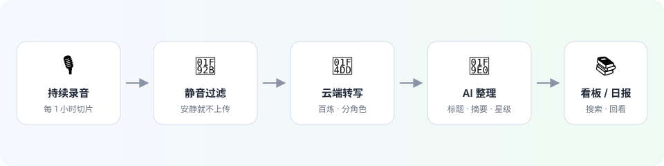
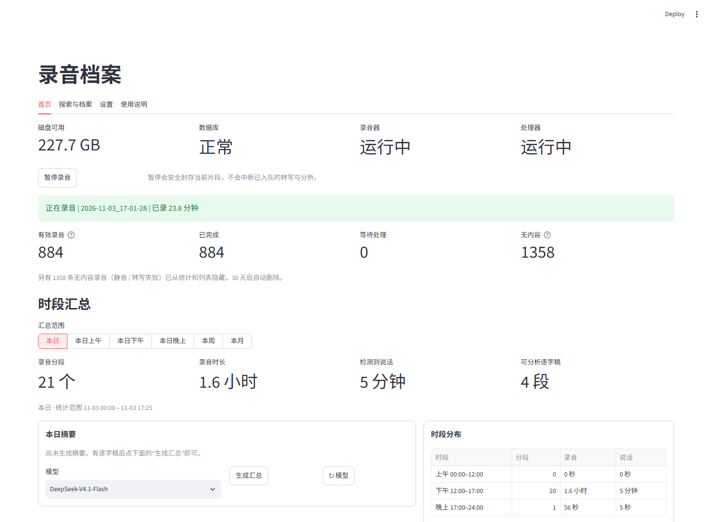

<div align="center">
  

  # 🎙 Voice Recorder

  **开机就录，关机就停。说过的每句话，自动变成能搜索、能回看的文字。**

  <sub>English: a Windows tray-free background recorder that transcribes, summarizes and archives your day automatically. Silent audio never leaves your machine.</sub>

  
  
  
  
</div>

---

## ✨ 一句话说清它是什么

装在自己笔记本上的小工具。它在后台安静地录下麦克风里的声音，**没声音的片段不会上传**；有内容的片段会被转成文字、自动起标题、打星级，最后在一个网页看板里按天排好，像翻书一样回看。

<p align="center"></p>

---

## 🎯 主要功能

| | 功能 | 说明 |
|---|---|---|
| 🎙 | **持续录音** | 开机自动开始，按小时切片，断了自己重连，不弹窗不打扰 |
| 🤫 | **静音不上传** | 本地先判断有没有人说话，安静片段只留本地，省流量也省钱 |
| 📝 | **自动转写** | 阿里云百炼异步转写，自带说话人区分，不用装任何本地模型 |
| 🧠 | **AI 整理** | 自动生成标题、摘要、人物/事件，0–5 星标出重要程度 |
| 🔎 | **全文搜索** | 关键词、日期、星级、标签、备注随便组合，几秒找到那句话 |
| 📚 | **按天回看** | 本日 / 上午 / 下午 / 晚上 / 本周 / 本月，像翻书一样看 |
| 📬 | **定时报告** | 每天固定时间把「今天录了什么」发到邮箱或飞书，关机错过的会补发 |
| 📥 | **导入旧录音** | 手机录音、会议录音拖进来，跟新录音一样转写、分析、归档 |
| 🔒 | **数据在本地** | 音频、逐字稿、分析都在自己电脑里，只有需要转写的片段上云 |

---

## 📸 界面长这样

<p align="center"></p>

> 首页：实时录音状态 · 磁盘/服务健康 · 今日统计 · 时段汇总（含摘要和时段分布）
>
> 🌐 界面支持 **简体中文 / English** 切换（右上角），默认简体中文。

---

## 🚀 三种开始方式

### 方式 A：下载安装包（最省事，推荐给小白）

1. 打开 [Releases](https://github.com/P-King999/Voice-Recording/releases) 页面
2. 下载最新的 `VoiceRecording-Setup-x.y.z.exe`
3. 双击安装（向导里可勾选「创建桌面快捷方式」）→ 从桌面或开始菜单打开 **Voice Recording**
   浏览器会自动打开 `http://localhost:8501`
4. 首次进入先设置一个看板密码（只用于本机网页登录），然后按引导填两个 API Key（见下一节）

> 安装包为当前用户安装，不需要管理员权限；升级时会保留录音、数据库和配置。

### 方式 B：从源码运行（适合想看代码的人）

```powershell
git clone https://github.com/P-King999/Voice-Recording.git
cd Voice-Recording
py -m venv .venv
.\.venv\Scripts\python.exe -m pip install -r requirements.txt
Copy-Item .env.example .env
```

用记事本打开 `.env`，填入两个 Key（见下一节），然后双击 **`Launch-VoiceRecorder.vbs`**。

### 方式 C：开机自动运行（强烈建议）

```powershell
.\Install-AutoStart.ps1
```

之后每次登录 Windows，它会在 30 秒后自己启动，你不用管。

---

## 🔑 需要准备两个 Key（都有免费额度）

| Key | 用来干嘛 | 去哪拿 |
|---|---|---|
| **百炼 DashScope** | 把语音转成文字 | [阿里云百炼](https://bailian.console.aliyun.com/) → 业务空间 → API-KEY |
| **DeepSeek** | 起标题、写摘要、算星级 | [DeepSeek 开放平台](https://platform.deepseek.com/) → API Keys |

两种填法任选其一：

- **在网页里填**（推荐）：首次打开看板时，引导页会让你直接粘贴，保存即生效。
- **在文件里填**：把 `deepseekkey.txt` 丢到项目根目录；百炼的 `*apiKey*.csv` 也可以直接放在根目录，程序会自动读取。

> ⚠️ `.env`、`*.csv`、`*key*.txt` 都已被 Git 忽略。**不要把 Key 发到群里或提交到 GitHub。**

---

## 🧭 看板怎么用（4 个页面）

| 页面 | 你会在这里做什么 |
|---|---|
| 🏠 **首页** | 看是否在录音、今天录了多久、本日/本周摘要，一键生成汇总 |
| 🔎 **搜索与档案** | 找录音：关键词、日期、状态、星级、标签、来源（录音/导入） |
| ⚙️ **设置** | 换麦克风、改录音时长、填 Key、设密码、开局域网访问、发日报 |
| 📖 **使用说明** | 忘了怎么操作时看这里，比 README 更细 |

**几条最常用的小技巧**

- 点开任意一条录音 → 播放、**点某一句直接跳到那句**、加书签、改标签和备注
- 星标 ⭐ 是重量级排序：0 星≈没内容，5 星≈必须回看
- 无内容录音（静音 / 转写失败）默认隐藏，30 天后自动进 Windows 回收站
- 「导入已有录音」支持单个文件、多个文件或整个文件夹，导入的会标记 `· 导入`

---

## 🗂 数据放在哪

```
data/
├─ recordings/   有声音的录音（含 imported/ 导入的副本）
├─ silent/       被判定为静音的片段（到期自动进回收站）
├─ failed/       多次处理失败的音频
└─ voice_recorder.sqlite3   逐字稿、分析、汇总、标签、备注
runtime/         日志和进程状态，出问题先看这里
```

想换保存位置：**设置 → 录音与存储 → 录音默认保存目录**。

---

## ❓ 常见问题

<details>
<summary><b>录了半天没有声音 / 全是“静音片段”？</b></summary>

多半是 Windows 默认输入被虚拟声卡抢走了（比如投屏、语音软件、Sonar）。
打开 **设置 → 录音设备**，点「测试麦克风」听一下，选真实麦克风（通常叫 `本机麦克风阵列 (Realtek …)`）再保存。
</details>

<details>
<summary><b>转写一直卡在“等待转写配置”？</b></summary>

百炼 Key 没填对，或该 Key 没有开通语音转写。去 **设置 → API 密钥** 重新粘贴一次，保存后等一分钟。
</details>

<details>
<summary><b>看板打不开？</b></summary>

先确认后台在跑：任务栏没有窗口是正常的（它本来就无界面运行）。
打开 PowerShell 执行 `.\Start-VoiceRecorder.ps1`，再访问 `http://localhost:8501`。
</details>

<details>
<summary><b>关机时正在录的那段会丢吗？</b></summary>

不会。程序会在下次启动时自动把没写完的录音文件修好并入库（历史上会产生 `.part.wav`，现在已经自动恢复）。
</details>

<details>
<summary><b>能录到系统声音 / 会议声音吗？</b></summary>

默认只录麦克风。要录系统声音需要装虚拟声卡（如 VB-CABLE），并在设置里把输入切成它。
</details>

<details>
<summary><b>会不会很占磁盘？</b></summary>

1 小时大约 100 MB。没内容的片段超过 30 天会自动移进回收站；也可以随时在档案页手动清理。
</details>

---

## 🛠 进阶玩法

更细的配置、定时日报、飞书机器人、QQ 邮箱查询、局域网手机访问、防止自动睡眠、完全停止服务 —— 都整理在这里：

**👉 [进阶使用与配置](docs/advanced.md)**

---

## 📄 许可

本项目使用 **MIT License**，可自由使用、修改和分发（保留版权声明）。

## ⚖️ 隐私与合规

录音涉及他人隐私和当地法律。**请只在取得同意的场合使用**，并且不要把这些数据随意分享。
所有音频和文字都在你自己电脑的 `data/` 目录里；只有需要转写的片段会上传到阿里云。

---

<div align="center">
  <sub>更新日志见 <a href="CHANGELOG.md">CHANGELOG.md</a> · 遇到问题先看 <a href="runtime/">runtime/</a> 里的日志</sub>
</div>
